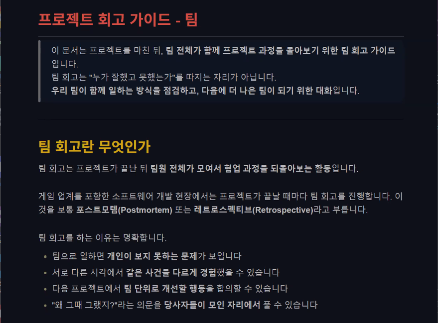
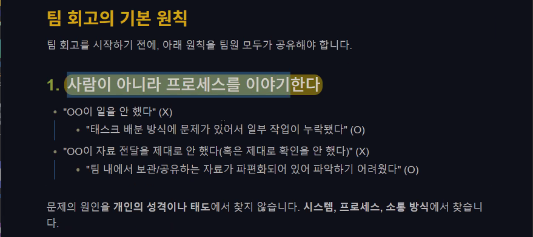
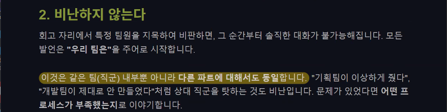
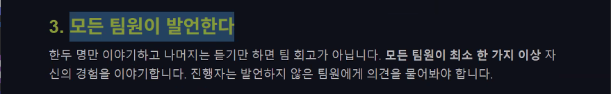
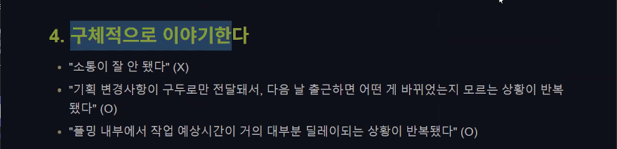
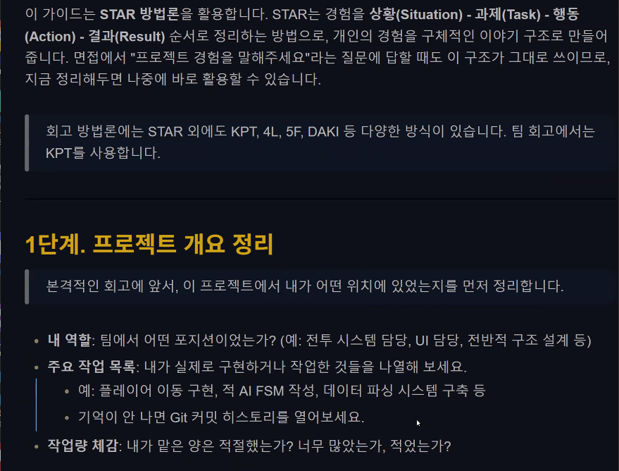
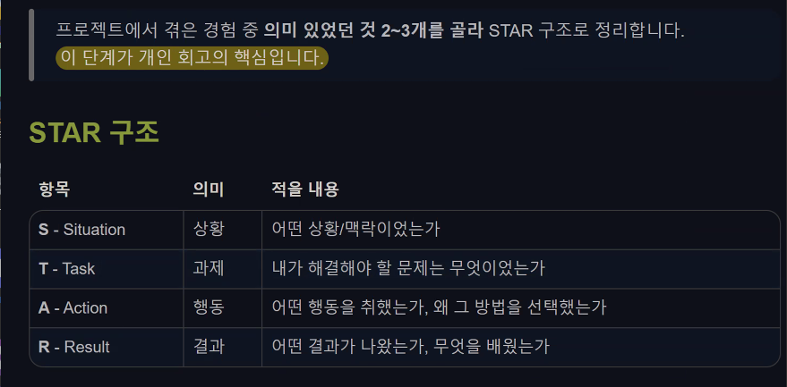
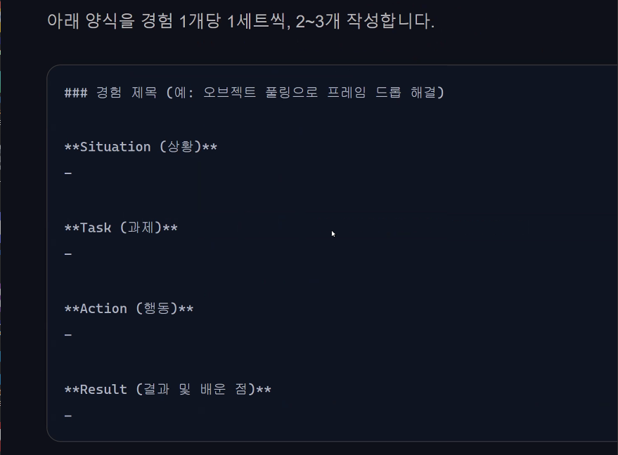
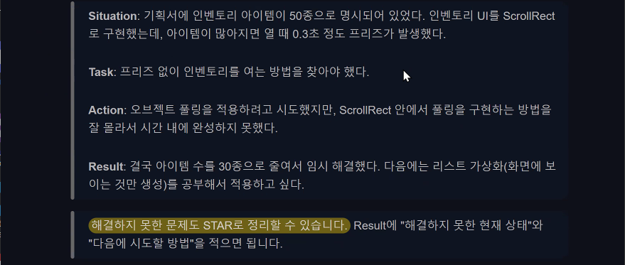

# 팀 프로젝트 사후 관리(1)
## 1. Unity 6 사전 설치
### 1.1. 설치 관련
- 앞으로 진행될 수업에서는 이 버전을 사용
- 버전은 6000.3.9f1로 진행 예정
- 모듈은 다음과 같이 설치한다.
  - Android
  - IOS
  - MAC
  - Window 

## 2. 팀 회고 가이드
### 2.1. 개요

- 가이드의 구조는 KPT(Keep, Problem, Try)로 이루어진다. 
- 잘한 것부터 시작하여 문제점에서 끝나지 않고 시도해볼 것들에 대한 것까지 이어져 구체적인 개선까지 도출할 수 있음.
- 상당히 중요함
- 신입 개발자에겐 기술 스택보단 성장폭과 일의 태도를 본다.
- 팀 단위에서도 회고는 많이 진행됨

### 2.2. 기본 원칙

### 2.3. KPT 이외의 방법: STAR
- 상황(Situation), 과제(Task), 행동(Action), 결과(Result) 순서로 정리한다.

## 3. 기술문서
### 3.1. STAR 회고론

- 항상 올바른 선택을 할 수 없음.
- 객관적인 글로 적어놨을 때, 자신에 대한 환멸이 느껴질 수 있음.

- ex) 몬스터 사망 시, 리소스 적용
- ex) 게임 플로우를 위한 UI 구조 프레이밍
- ex) 일시 정지 후, 메인 메뉴로 돌아갈 때 BGM 꺼짐 현상
- 행동에는 차선책도 적어놓는 것이 좋다. 
- 결과에는 더 좋은 방법을 적어두는 것이 좋다. 
- 예시는 다음과 같다.

